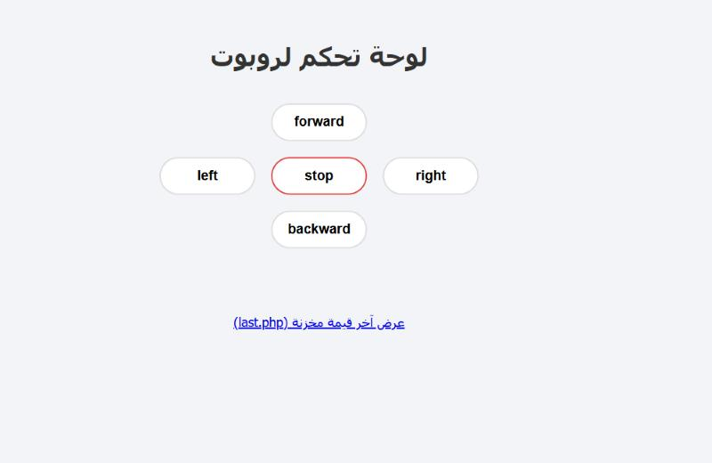
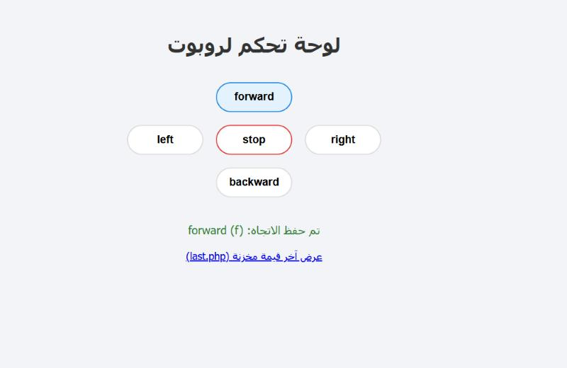
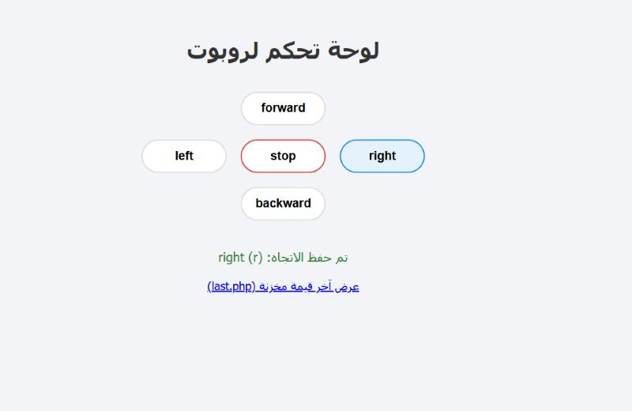

# المهمة الثالثة – لوحة تحكم لروبوت

صفحة ويب باستخدام **HTML و CSS و JavaScript و PHP و MySQL** تقوم بما يلي:

- لوحة تحكم فيها 5 أزرار: forward, left, stop, right, backward.
- حفظ الاتجاه المضغوط في جدول MySQL.
- صفحة PHP (`last.php`) تجلب وتعرض آخر قيمة مخزنة في قاعدة البيانات.

---

## الخطوة 1: تثبيت البرامج

1. حمّل وثبّت **XAMPP** من: https://www.apachefriends.org/download.html
2. افتح **XAMPP Control Panel** واضغط **Start** بجانب **Apache** و **MySQL**.
3. انسخ هذا المجلد `task2-robot-control` إلى المسار:
   ```
   C:\xampp\htdocs\
   ```

## الخطوة 2: إنشاء قاعدة البيانات

1. افتح المتصفح على: http://localhost/phpmyadmin
2. اختر تبويب **SQL**.
3. انسخ محتوى الملف `database.sql` والصقه ثم اضغط **Go**.

سيتم إنشاء قاعدة `robot_db` وفيها جدول `directions`:

| العمود | النوع | الوصف |
|---|---|---|
| `id` | INT | رقم السجل (يزيد تلقائياً) |
| `direction` | CHAR(1) | حرف الاتجاه |
| `created_at` | TIMESTAMP | وقت الضغط |

## الخطوة 3: تشغيل الصفحات

| الصفحة | الرابط |
|---|---|
| لوحة التحكم | http://localhost/task2-robot-control/ |
| آخر قيمة مخزنة | http://localhost/task2-robot-control/last.php |

> ⚠️ لا تفتح الملفات بالضغط عليها مباشرة من المجلد، لأن المتصفح لا يشغّل PHP، بل يجب فتحها عن طريق `localhost`.

---

## الحروف المستخدمة

| الزر | الحرف المخزن |
|---|---|
| forward | `f` |
| backward | `b` |
| left | `l` |
| right | `r` |
| stop | `s` |

## شرح الملفات

| الملف | الوظيفة |
|---|---|
| `database.sql` | إنشاء قاعدة البيانات `robot_db` والجدول `directions` |
| `config.php` | الاتصال بقاعدة البيانات باستخدام `mysqli` (المستخدم `root` بدون كلمة مرور، وهي إعدادات XAMPP الافتراضية) |
| `index.html` | لوحة التحكم: 5 أزرار مرتبة على شكل علامة + |
| `style.css` | تنسيق الأزرار باستخدام CSS Grid |
| `script.js` | دالة `sendDirection()` ترسل حرف الاتجاه إلى `save.php` باستخدام `fetch` وتعرض رسالة تأكيد |
| `save.php` | يتحقق أن الحرف مسموح (f, b, l, r, s) ثم يحفظه في الجدول بـ `INSERT` |
| `last.php` | يجلب آخر سجل بـ `SELECT direction FROM directions ORDER BY id DESC LIMIT 1` ويطبع الحرف فقط |

## طريقة العمل خطوة بخطوة

1. المستخدم يفتح لوحة التحكم ويضغط زر اتجاه، مثلاً **forward**.
2. `script.js` يرسل الحرف `f` بطريقة `POST` إلى `save.php` باستخدام `fetch`.
3. `save.php` يتأكد أن الحرف من الحروف المسموحة، ثم يحفظه في جدول `directions` باستخدام **Prepared Statement**.
4. تظهر رسالة تأكيد في الصفحة: "تم حفظ الاتجاه: forward (f)".
5. عند فتح `last.php` تظهر آخر قيمة فقط (مثلاً `f`).
6. يمكن للروبوت (مثل ESP32 المتصل بنفس الشبكة) قراءة صفحة `last.php` لمعرفة الأمر الحالي وتنفيذه.

> إذا كان الجدول فارغاً، تعرض `last.php` الحرف `s` (stop) كقيمة افتراضية حتى لا يتحرك الروبوت.

---

## صور التشغيل والاختبار

### 1) لوحة التحكم


### 2) الضغط على forward وظهور رسالة الحفظ


### 3) صفحة last.php تعرض آخر قيمة: f


### 4) الضغط على right


### 5) صفحة last.php تعرض آخر قيمة: r


---

## الرفع على GitHub

```bash
cd C:\xampp\htdocs\task2-robot-control
git init
git add .
git commit -m "Robot control panel with PHP and MySQL"
git branch -M main
git remote add origin https://github.com/alkhaldi-omar/task2-robot-control.git
git push -u origin main
```

